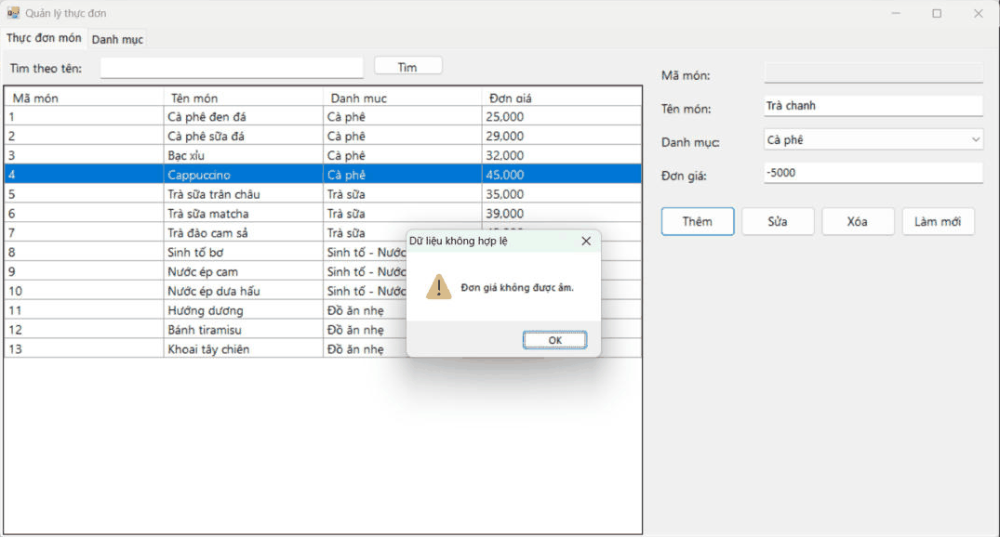

# BÀI TẬP 5.3 – HỆ THỐNG QUẢN LÝ QUÁN CAFE & BÁN HÀNG (POS CAFE SYSTEM)

Ứng dụng WinForms (C#, .NET Framework 4.8) kết nối SQL Server bằng ADO.NET, xây dựng theo kiến trúc 3 lớp **DTO – DAL – BUS – GUI**.

## MỤC 1: THÔNG TIN SINH VIÊN

- **Họ và tên sinh viên:** Trần Nhật Đông
- **Mã sinh viên:** 24810320177
- **Lớp:** D19QTANM1
- **Tên Đề tài / Bài tập:** Bài 5.3 – Hệ thống quản lý quán Cafe & bán hàng (POS)

## MỤC 2: HƯỚNG DẪN CÀI ĐẶT & CHẠY DỰ ÁN

**Yêu cầu:** Visual Studio 2022 (workload *.NET desktop development*, đã kèm SQL Server Express LocalDB).

1. Mở file `CafePOS.sln` bằng Visual Studio 2022.
2. Build & Run dự án (F5). Ở lần chạy đầu, chương trình tự kiểm tra: nếu chưa có CSDL `CafePOSDB` thì tự chạy file `Database/ScriptDB.sql` để tạo bảng và dữ liệu mẫu (lớp `DAL/DbInit.cs`).
3. Mặc định chuỗi kết nối dùng `(localdb)\MSSQLLocalDB`. Nếu muốn dùng SQL Server khác, sửa `Data Source` trong `CafePOS/App.config` (ví dụ `.\SQLEXPRESS`).
4. Có thể chạy thủ công `Database/ScriptDB.sql` bằng SQL Server Management Studio (SSMS) nếu muốn tạo lại CSDL từ đầu.

## Cấu trúc thư mục

```
├── Database/
│   └── ScriptDB.sql            # Tạo CSDL CafePOSDB (5 bảng) + dữ liệu mẫu
├── CafePOS/
│   ├── DTO/                    # BanAnDTO, DanhMucDTO, MonAnDTO, HoaDonDTO
│   ├── DAL/                    # DatabaseHelper, BanAnDAL, DanhMucDAL, MonAnDAL, HoaDonDAL
│   ├── BUS/                    # BanAnBUS, DanhMucBUS, MonAnBUS, HoaDonBUS (validation nghiệp vụ)
│   ├── GUI/                    # FrmMain, FrmQuanLyThucDon, FrmBaoCao
│   ├── App.config              # Chuỗi kết nối
│   └── Program.cs
├── images/                     # Ảnh chụp màn hình kết quả
├── README.md
└── CafePOS.sln
```

## Chức năng đã thực hiện

| Yêu cầu đề bài | Cách thực hiện |
|---|---|
| Mô hình ngắt kết nối nạp menu | `MonAnDAL.LoadMenuDataSet()` dùng **SqlDataAdapter** đổ 2 bảng DanhMuc, MonAn vào một **DataSet** (có DataRelation); khi đổi danh mục chỉ lọc bằng **DataView.RowFilter**, không truy vấn lại CSDL |
| Sơ đồ bàn | Danh sách **Button tạo động** theo bảng BanAn; bàn *Trống* màu xanh, *Có khách* màu đỏ, bàn đang chọn có viền vàng |
| Gọi món | Chọn bàn → nạp các món đã gọi vào **DataGridView** bằng SqlDataAdapter + DataTable; chọn danh mục, món, số lượng → *Thêm món*; bàn tự chuyển sang *Có khách*. Có thêm chức năng *Bớt món* |
| Đổi bàn | Chuyển hóa đơn đang mở sang bàn trống khác (trong SqlTransaction) |
| Thanh toán | `HoaDonDAL.ThanhToan()`: tính tổng tiền → cập nhật GioRa, TongTien, TrangThai = 1 → trả bàn về *Trống*; **tất cả nằm trong một SqlTransaction**, lỗi thì Rollback |
| Quản lý thực đơn (3-Tier CRUD) | `FrmQuanLyThucDon`: Thêm / Sửa / Xóa / Tìm kiếm món và danh mục. Lớp BUS chặn **tên món để trống** và **đơn giá âm** |
| Báo cáo | `FrmBaoCao`: hóa đơn đã thanh toán theo khoảng ngày, Top 5 món bán chạy, tổng doanh thu tính bằng **ExecuteScalar** |
| Chống SQL Injection | Mọi câu lệnh đều dùng **SqlParameter** |

## MỤC 3: HÌNH ẢNH KẾT QUẢ CÁC MÀN HÌNH CHỨC NĂNG

1. Màn hình Chính / Tổng quan (sơ đồ bàn):
   
2. Màn hình Quản lý Danh mục / Thêm Sửa Xóa (CRUD):
   
3. Màn hình Thực thi Nghiệp vụ chính (Gọi món / Thanh toán):
   
4. Màn hình Báo cáo - Thống kê:
   
5. Minh họa xử lý lỗi (nhập đơn giá âm / tên món trống bị chặn):
   
